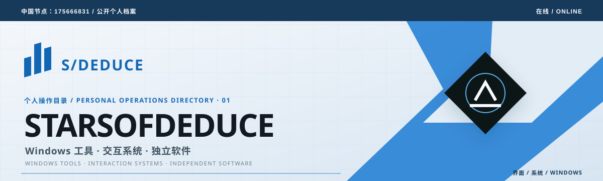
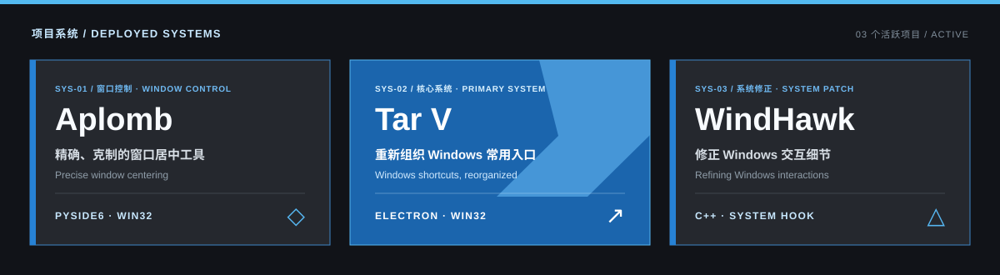

  

  <a href="https://starsofdeduce.github.io/"><strong>个人主页 / Website</strong></a>
  &nbsp;·&nbsp;
  <a href="https://github.com/StarsofDeduce?tab=repositories"><strong>项目仓库 / Repositories</strong></a>
  &nbsp;·&nbsp;
  <a href="https://github.com/StarsofDeduce/StarsofDeduce/issues"><strong>联系 / Issues</strong></a>

## 个人档案 / Personal file

> 在代码、系统与界面之间，建立自己的秩序。 
> *Building order at the intersection of code, systems, and interfaces.*

独立开发者，专注 **Windows 工具、系统交互与界面结构**。我喜欢把复杂实现留在底层，让界面保持清楚、克制，并真正减少操作成本。

Independent developer focused on Windows utilities, system integration, and interface architecture—keeping complexity below the surface so everyday interactions stay clear and efficient.

<table>
  <tr>
    <td><strong>平台 / BASE</strong> GitHub · Windows</td>
    <td><strong>方向 / FOCUS</strong> 效率与体验 Efficiency &amp; experience</td>
    <td><strong>状态 / STATUS</strong> 持续构建 Continuously building</td>
  </tr>
</table>

## 项目系统 / Deployed systems

  

| 编号 / ID | 项目 / Project | 解决的问题 / Problem | 技术路径 / Stack |
|:---:|---|---|---|
| `SYS-01` | [**Aplomb**](https://github.com/StarsofDeduce/Aplomb) | 按可见边框精确居中 Windows 窗口 Precise centering by the visible frame | Python · PySide6 · Win32 |
| `SYS-02` | [**Tar V**](https://github.com/StarsofDeduce/Tar-V) | 以轻量面板重新组织 Windows 常用入口 Reorganizes shortcuts into a lightweight panel | Electron · Node.js · Win32 |
| `SYS-03` | [**WindHawk**](https://github.com/StarsofDeduce/WindHawk) | 修正持续影响体验的 Windows 交互细节 Refines persistent Windows interaction details | C++ · System hooks |

## 技术栈 / System stack

`Python` · `PySide6` · `C++` · `Win32` · `Electron` · `TypeScript` · `JavaScript` · `HTML/CSS` · `PowerShell`

## 工作札记 / Knowledge archive

开发过程、实现边界与设计判断会整理到 [**个人主页**](https://starsofdeduce.github.io/)。这里不堆砌装饰性的活动统计，只保留能说明我在构建什么、为什么构建的内容。

Development notes, implementation boundaries, and design decisions live on my personal website. This profile keeps only what explains what I build and why.

  

<!-- GitHub 原生贡献热力图会继续显示在 Profile README 与置顶仓库之后，无需嵌入第三方图片。 -->
